<div align="center">



# 🌐 Awesome Cloud API Gateway & Integration Ecosystem

<p align="center">
  <a href="https://github.com/ishandutta2007/Awesome-Awesome-Awesome"></a>
  <a href="https://discord.gg/jc4xtF58Ve"></a>
  <a href="https://awesome.re"></a>
  <a href="https://github.com/ishandutta2007/Awesome-Cloud-API-Gateway-Integration/stargazers"></a>
  <a href="https://github.com/ishandutta2007/Awesome-Cloud-API-Gateway-Integration/network/members"></a>
  <a href="https://github.com/ishandutta2007"></a>
</p>

<p align="center">
  <b>A comprehensive, curated catalog of top-tier Cloud API Gateways, API Management (APIM) Platforms, Reverse Proxies, and Open-Source Service Connectivity Engines.</b>
</p>

</div>

---

## 📑 Table of Contents
- [📊 Sector Overview & Market Dynamics](#-sector-overview--market-dynamics)
- [☁️ SaaS & Hosted Cloud API Platforms](#️-saas--hosted-cloud-api-platforms)
- [🔓 Open-Source GitHub Projects](#-open-source-github-projects)
- [🏛️ Architecture & Feature Comparison](#️-architecture--feature-comparison)
- [🤝 How to Contribute](#-how-to-contribute)
- [💖 Support & Sponsorship](#-support--sponsorship)
- [📈 Star History](#-star-history)
- [⚠️ Disclaimer](#️-disclaimer)

---

## 📊 Sector Overview & Market Dynamics

The standalone **API Gateway market** is valued at approximately **$3.6 billion** and projected to expand to **$15.6+ billion by the mid-2030s** (~15.6% CAGR), with the broader **API Management & Integration market** encompassing **$8.7B to $10.3B+**. 

The sector is **moderately concentrated**:
- 🏢 **Entrenched Hyperscalers & Enterprise Leaders**: Giants like Microsoft Azure, AWS, Google Cloud (Apigee), and Salesforce (MuleSoft) capture large enterprise core spend by bundling robust API governance into expansive cloud contracts.
- ⚡ **Dynamic Cloud-Native & Open-Source Innovators**: Specialized vendors and high-velocity open-source projects (Kong, Traefik, Envoy, Apache APISIX) drive developer-led, Kubernetes-first adoption and AI-proxy workload orchestration.

---

## ☁️ SaaS & Hosted Cloud API Platforms

Below is an enterprise breakdown of leading hosted and cloud-native API management platforms, sorted in descending order by parent company scale (market capitalization / valuation):

| Product | 🏢 Company Size / Valuation | 📝 Description | 💳 Pricing (Starting Tier) | 🎁 Free Tier Limits / Free Trial Plan |
|---|---|---|---|---|
| **[Azure API Management](https://azure.microsoft.com/en-us/products/api-management/)** | **~$3.1 Trillion** (Microsoft Market Cap) | Scalable multi-cloud API gateway with developer portal, API monetization, and hybrid deployment via self-hosted gateway. | Consumption tier: **$0.0035 per 10,000 calls**; Basic tier from **~$0.07/hour** (~$51/month). | **Free forever**: First 1,000,000 calls/month free in Consumption tier; Developer evaluation tier available. |
| **[Apigee](https://cloud.google.com/apigee)** | **~$2.2 Trillion** (Alphabet / Google Market Cap) | Enterprise API management platform with advanced traffic analytics, AI proxy governance, API security, and developer portal. | Pay-as-you-go Base Environment starts at **$0.50/hour/region** (~$365/month) + **$20/million API calls**. | **60-day free evaluation plan** with full environment access; no permanent free production tier. |
| **[AWS API Gateway](https://aws.amazon.com/api-gateway/)** | **~$2.1 Trillion** (Amazon Market Cap / AWS ~$180B+ Run Rate) | Fully managed serverless API gateway supporting REST, HTTP, and WebSocket APIs at hyperscale. | HTTP APIs start at **$1.00 per million calls**; REST APIs start at **$3.50 per million calls**. | **12-month free tier**: 1,000,000 calls/month for HTTP, 1,000,000 for REST, and 1,000,000 for WebSocket APIs (plus $200 credit on eligible new accounts). |
| **[MuleSoft Anypoint](https://www.mulesoft.com/)** | **~$190 Billion** (Salesforce Market Cap / Acquisition) | Enterprise iPaaS and unified API lifecycle management connecting SaaS apps, legacy systems, and data pipelines. | MuleSoft Entry Packages start at **$2,000/month** (billed annually using shared Mule Credits). | **30-day free trial** with access to Anypoint Design Center, API Manager, and sample runtime flows. |
| **[Freshworks API Gateway](https://www.freshworks.com/)** | **~$3.3 Billion** (Freshworks Market Cap) | Unified API access layer for Freshworks CRM and customer support ecosystems with programmatic automation. | Freshsales starts from **$9/user/month**; Freshdesk starts from **$19/agent/month** (annual billing). | **Free forever plan**: Up to 3 users on Freshsales; 14-to-21-day unrestricted trials across products. |
| **[Kong Konnect](https://konghq.com/)** | **~$2.0 Billion** (Private Valuation / $100M+ ARR) | Cloud-managed control plane orchestrating Kong Gateway instances across multi-cloud and Kubernetes clusters. | Serverless Gateway: **$25/month/control plane**; Hybrid Gateway: **$200/month** (includes 1M requests, then $200/M overage). | **Kong Gateway OSS is 100% free forever** (MPL-2.0); Konnect offers a 30-day free enterprise cloud trial. |
| **[WSO2 API Manager](https://wso2.com/api-manager/)** | **~$600 Million** (Valuation / EQT Acquisition) | Full lifecycle API manager supporting REST, GraphQL, and async streaming protocols with hybrid gateways. | SaaS Pay-As-You-Go starts at **$119/month** (covers 10 managed interfaces and 10 million gateway events). | **30-day free trial**: Up to 5 managed interfaces, 1 million gateway events, 1 hybrid gateway, and 1 developer portal. |
| **[Tyk Cloud](https://tyk.io/)** | **~$150 Million - $250 Million** (Dealroom/Preqin Est. / $41M+ Raised) | High-performance API management platform with native GraphQL engine, API designer, and distributed gateways. | Core Cloud plan starts at **$600/month** (usage-based, metered by managed API count). | **Tyk Gateway OSS is 100% free forever** (MPL-2.0); Tyk Cloud provides a **48-hour fully featured trial** (no credit card required). |
| **[Gravitee.io](https://www.gravitee.io/)** | **~$125M+ Raised** (Series C Backed) | Event-native and REST API management platform bridging asynchronous event streams (Kafka, MQTT) and synchronous APIs. | Managed Planet tier starts at **$2,500/month** (includes 1 production gateway, 1 non-prod gateway, and 1 core module). | **Gravitee OSS is 100% free forever** (Apache 2.0); commercial enterprise trials available via sales demo. |
| **[Traefik Hub](https://traefik.io/)** | **~$50M - $80M** (Series A Backed / $11M+ Raised) | Kubernetes-native API gateway and management control plane built atop open-source Traefik Proxy. | Commercial annual packages start at **$30,000/year** (~$2,500/month) for the Hub Basic License tier via AWS Marketplace. | **Traefik Proxy OSS is 100% free forever** (MIT); Traefik Hub offers a **30-day free trial** for API Gateway features. |

---

## 🔓 Open-Source GitHub Projects

Explore the most popular open-source API gateways, reverse proxies, and integration engines. Projects are sorted in descending order by GitHub stargazer count:

| Project | ⭐ Stars | 📜 License | 📝 Description |
|---|:---:|:---:|---|
| **[Traefik Proxy](https://github.com/traefik/traefik)** | [](https://github.com/traefik/traefik/stargazers) | MIT | Cloud-native reverse proxy and ingress controller featuring dynamic automatic service discovery from Docker, Kubernetes, and Consul. |
| **[Kong Gateway](https://github.com/Kong/kong)** | [](https://github.com/Kong/kong/stargazers) | Apache-2.0 / MPL-2.0 | High-throughput, modular cloud-native API and AI gateway written in Lua/OpenResty with a vast plugin registry. |
| **[Envoy Proxy](https://github.com/envoyproxy/envoy)** | [](https://github.com/envoyproxy/envoy/stargazers) | Apache-2.0 | High-performance C++ edge/service proxy and communication bus designed for cloud-native microservices architectures (CNCF Graduated). |
| **[Cloudflare Pingora](https://github.com/cloudflare/pingora)** | [](https://github.com/cloudflare/pingora/stargazers) | Apache-2.0 | High-performance, memory-safe asynchronous Rust framework engineered by Cloudflare for building programmable HTTP/TLS reverse proxies and API gateways. |
| **[Apache APISIX](https://github.com/apache/apisix)** | [](https://github.com/apache/apisix/stargazers) | Apache-2.0 | Dynamic, high-speed API and AI gateway built on NGINX and etcd offering hot-reloading of routing rules and multi-language plugin support. |
| **[Tyk Gateway](https://github.com/TykTechnologies/tyk)** | [](https://github.com/TykTechnologies/tyk/stargazers) | MPL-2.0 | Lightweight, blazing-fast Go-based API gateway supporting REST, GraphQL, gRPC, and Model Context Protocol (MCP) mediation. |
| **[Apache Camel](https://github.com/apache/camel)** | [](https://github.com/apache/camel/stargazers) | Apache-2.0 | Versatile enterprise integration framework implementing 350+ connectors across messaging queues, databases, cloud providers, and SaaS APIs. |
| **[Emissary-Ingress](https://github.com/emissary-ingress/emissary)** | [](https://github.com/emissary-ingress/emissary/stargazers) | Apache-2.0 | Kubernetes-native API gateway and ingress controller built on Envoy Proxy supporting declarative CRD configuration and traffic management. |
| **[Envoy Gateway](https://github.com/envoyproxy/gateway)** | [](https://github.com/envoyproxy/gateway/stargazers) | Apache-2.0 | The official Kubernetes Gateway API controller implementation powered by Envoy Proxy, translating Gateway API specs directly into Envoy xDS configuration. |
| **[KrakenD](https://github.com/krakend/krakend-ce)** | [](https://github.com/krakend/krakend-ce/stargazers) | Apache-2.0 | Ultra-fast, stateless, declarative API gateway in Go capable of aggregating multiple microservice backend responses into single endpoints with zero custom code. |
| **[WSO2 API Manager](https://github.com/wso2/product-apim)** | [](https://github.com/wso2/product-apim/stargazers) | Apache-2.0 | Full open-source API management suite containing an API gateway, developer publisher portal, analytics engine, and key management service. |
| **[Gravitee API Management](https://github.com/gravitee-io/gravitee-api-management)** | [](https://github.com/gravitee-io/gravitee-api-management/stargazers) | Apache-2.0 | Comprehensive event-native API management system covering synchronous HTTP and asynchronous streaming protocols (Kafka, RabbitMQ, Webhooks). |

---

## 🏛️ Architecture & Feature Comparison

```
+-------------------------------------------------------------------------------+
|                             CLIENT APPLICATIONS                               |
|              (Single Page Apps, Mobile, Third-Party Developers, IoT)           |
+-------------------------------------------------------------------------------+
                                      │
                                      ▼ HTTPS / gRPC / WebSockets
+───────────────────────────────────────────────────────────────────────────────+
|                           API GATEWAY INGRESS LAYER                           |
|  [TLS Termination] [Auth & JWT Validation] [Rate Limiting] [IP Whitelisting]  |
|  [WAF Security]    [Request Transformation] [Distributed Cache] [CORS Header] |
+───────────────────────────────────────────────────────────────────────────────+
          │                             │                              │
          ▼                             ▼                              ▼
+───────────────────+         +───────────────────+          +──────────────────+
|  Microservice A   |         |   Microservice B  |          |   Third-Party    |
|   (REST / gRPC)   |         |    (Async Event)  |          |     SaaS API     |
+───────────────────+         +───────────────────+          +──────────────────+
```

### 🎯 Key Selection Criteria

- 🚀 **Throughput & Latency Needs**: Ultra-low latency requirements favor C++ / Rust / Go implementations such as **Envoy Proxy**, **Pingora**, **KrakenD**, or **Traefik**.
- ☸️ **Kubernetes Ingress Alignment**: If your architecture runs on K8s and uses standard Gateway API specifications, prioritize **Envoy Gateway**, **Traefik Proxy**, or **Emissary-Ingress**.
- 📨 **Event-Driven & Asynchronous Systems**: If you route Kafka, RabbitMQ, or MQTT messages alongside REST, review **Gravitee.io** or **Apache Camel**.
- ☁️ **Managed Hyperscaler Serverless**: If you want zero infrastructure maintenance on native cloud services, select **AWS API Gateway**, **Azure API Management**, or **Apigee**.

---

## 🤝 How to Contribute

We welcome additions, fixes, and updates from the open-source and developer community!

1. 🍴 **Fork the repository** to your GitHub account.
2. 🌿 **Create a descriptive branch**: `git checkout -b add-gateway-platform`.
3. 📝 **Add or update an entry** in `README.md` maintaining the existing tabular schema (including pricing, free limits, and official links).
4. 🚀 **Submit a Pull Request** with a concise description of your changes.

---

## 💖 Support & Sponsorship

If this curated list helps you architect, benchmark, or deploy API gateways and cloud-native integrations, please consider supporting the project:

- ⭐ **Star this repository** to help others discover it!
- 🍴 **Fork and contribute** to keep entries fresh and accurate.
- 📢 **Share with your network** on Twitter/X, LinkedIn, Reddit, or Discord.
- ☕ **Buy a coffee / Sponsor**: Support ongoing maintenance and curation on the [GitHub Sponsors Dashboard](https://github.com/sponsors/ishandutta2007).

---

##  Star History
[](https://www.star-history.com/#ishandutta2007/Awesome-Cloud-API-Gateway-Integration&type=date&legend=top-left)

---

## ⚠️ Disclaimer

- This curated repository is maintained for informational and architectural guidance purposes.
- Product pricing and free tier terms are subject to change by respective cloud and SaaS vendors; refer to the linked official provider pricing sheets before architectural commitment.

---

<div align="center">
  <sub>Maintained with ❤️ by the Cloud Infrastructure & Platform Engineering Community.</sub>
</div>
